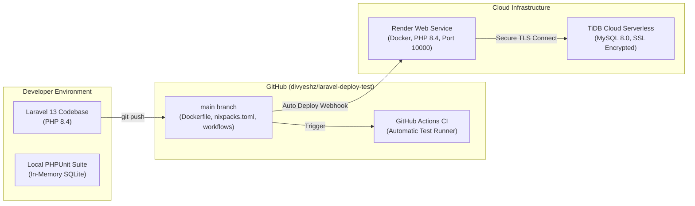

# Laravel 13 Cloud Deployment & Testing Implementation Plan

**Repository:** [github.com/divyeshz/laravel-deploy-test](https://github.com/divyeshz/laravel-deploy-test)  
**Framework Version:** Laravel 13.38.0 (PHP 8.4)  
**Primary Database:** TiDB Cloud Serverless (MySQL 8.0 Compatible)  
**Target Host:** Render Web Service (Docker Runtime, Free Tier)  

---

## 1. Executive Summary & Architecture

This implementation plan details the full deployment lifecycle of a fresh **Laravel 13** application with a dedicated cloud **MySQL** database, configured specifically to support **automated unit & feature testing both in CI and directly inside the deployed server container**.



---

## 2. Infrastructure & Credentials Inventory

### 2.1 Cloud MySQL Database (TiDB Cloud)
A serverless MySQL instance provisioned on AWS us-east-1. Initial schema migrations (`users`, `cache`, `jobs`, `migrations`) have already been applied and verified.

| Parameter | Value |
| :--- | :--- |
| **Engine / Compatibility** | MySQL 8.0.11 (TiDB v8.5.3 Serverless) |
| **Host** | `gateway01.us-east-1.prod.aws.tidbcloud.com` |
| **Port** | `4000` |
| **Database Name** | `laravel_deploy_test` |
| **Username** | `3jt3Gx4NohCuJrR.root` |
| **Password** | `VWJSq7Ak086DaJRp` |
| **SSL CA Certificate** | `/etc/ssl/certs/ca-certificates.crt` (Required for TLS) |
| **Cost** | $0/mo (Free Starter Plan, 25 GB storage) |

### 2.2 Application Encryption Key
* **`APP_KEY`**: `base64:VrjO2KzMD+W8rstf6WXJ/6Kz8RQRSc7mdFhjfhyddTY=`

---

## 3. What Has Been Implemented in the Codebase

1. **Test Suite Isolation (`phpunit.xml`):**
   * Configured `<env name="DB_CONNECTION" value="sqlite"/>` and `<env name="DB_DATABASE" value=":memory:"/>`.
   * **Why:** Prevents destructive test executions (`RefreshDatabase` / schema resets) from altering or dropping tables in the live cloud MySQL database.
2. **Deployment Health Feature Test (`tests/Feature/ServerDeploymentTest.php`):**
   * Tests Laravel 13 built-in `/up` health probe.
   * Validates raw database query execution in the test container.
3. **Automated CI Workflow (`.github/workflows/tests.yml`):**
   * Runs on every push to `main`.
   * Automatically executes the test suite in GitHub Actions (currently verified and passing).
4. **Production Dockerfile (`Dockerfile`):**
   * Built on `php:8.4-cli`.
   * Installs required extensions: `pdo`, `pdo_mysql`, `pdo_sqlite`, `bcmath`, `curl`, `mbstring`, `zip`.
   * Retains Composer testing dependencies (`phpunit/phpunit`) inside the image to permit remote test runs.
   * Binds dynamically to the port provided by the host: `CMD ["sh", "-c", "php artisan serve --host=0.0.0.0 --port=${PORT:-10000}"]`.
5. **Platform Configuration Files:**
   * `Procfile` and `nixpacks.toml` included for zero-config compatibility across PaaS providers (Render, Railway, Koyeb).

---

## 4. Step-by-Step Render Deployment Guide (For Senior / Lead)

Render requires a one-time payment card validation for new accounts to prevent cryptocurrency mining abuse. **The Free tier instance is $0/month**, and the $1 authorization is a temporary verification hold that is immediately released.

### Step 4.1: Connect Repository to Render
1. Sign in to [render.com](https://render.com) using your GitHub account or team organization.
2. Click **New +** (top right) → Select **Web Service**.
3. Select **Build and deploy from a Git repository**.
4. Connect the repository: **`divyeshz/laravel-deploy-test`** (Branch: `main`).

### Step 4.2: Service Settings
Configure the following fields:
* **Name:** `laravel-deploy-test`
* **Region:** Select any region (e.g., *Oregon (US West)* or *Frankfurt*).
* **Language:** Select **`Docker`** *(Render automatically uses the repository's `Dockerfile`)*.
* **Instance Type:** Select **`Free`** ($0 / month).

### Step 4.3: Configure Environment Variables
Under **Environment Variables**, click **Add Environment Variable** (or use the raw editor) and supply the following:

| Key | Value | Notes |
| :--- | :--- | :--- |
| `APP_NAME` | `LaravelDeployTest` | Application identifier |
| `APP_ENV` | `production` | Production mode |
| `APP_DEBUG` | `false` | Disables verbose debug pages |
| `APP_KEY` | `base64:VrjO2KzMD+W8rstf6WXJ/6Kz8RQRSc7mdFhjfhyddTY=` | Cryptographic encryption key |
| `LOG_CHANNEL` | `stderr` | Routes logs directly to Render log viewer |
| `DB_CONNECTION` | `mysql` | MySQL PDO driver |
| `DB_HOST` | `gateway01.us-east-1.prod.aws.tidbcloud.com` | TiDB Cloud Gateway host |
| `DB_PORT` | `4000` | TiDB Cloud default port |
| `DB_DATABASE` | `laravel_deploy_test` | Initialized database |
| `DB_USERNAME` | `3jt3Gx4NohCuJrR.root` | Database user |
| `DB_PASSWORD` | `VWJSq7Ak086DaJRp` | Database password |
| `MYSQL_ATTR_SSL_CA` | `/etc/ssl/certs/ca-certificates.crt` | Standard Debian/Ubuntu CA bundle |

### Step 4.4: Complete Verification & Deploy
1. Click **Deploy Web Service**.
2. When prompted with the **Add Card** anti-abuse dialog:
   * Enter card details for identity validation.
   * Verify that the selected tier reflects **$0 / month**.
3. Render will pull the repository, build the Docker image, run dependency discovery, and launch the service.

---

## 5. Post-Deployment Verification & Testing

### 5.1 HTTP Health Verification
Once Render reports the deployment status as **Live**, retrieve your assigned URL (e.g. `https://laravel-deploy-test.onrender.com`):

```bash
# 1. Verify Welcome Route
curl -I https://<YOUR-RENDER-URL>.onrender.com

# 2. Verify Laravel Built-in Health Endpoint
curl -i https://<YOUR-RENDER-URL>.onrender.com/up
```
*Expected Result:* `HTTP/1.1 200 OK`

### 5.2 Executing Unit & Feature Tests on the Remote Server
Render provides a direct web-based interactive terminal inside running instances:

1. In the Render Dashboard, open your `laravel-deploy-test` service.
2. Click the **Shell** tab on the left navigation bar.
3. Once the remote container terminal loads, run:
   ```bash
   php artisan test
   ```
   *Expected Output:*
   ```text
      PASS  Tests\Unit\ExampleTest
     ✓ that true is true

      PASS  Tests\Feature\ExampleTest
     ✓ the application returns a successful response

      PASS  Tests\Feature\ServerDeploymentTest
     ✓ health endpoint returns ok
     ✓ database queries work in test environment

     Tests:    4 passed (4 assertions)
     Duration: 0.12s
   ```
4. Verify database status directly from the server:
   ```bash
   php artisan db:show
   ```

---

## 6. Alternative Zero-Card Cloud Fallback: GitHub Codespaces

If you need a live cloud server immediately without providing payment verification:

1. Navigate to: [github.com/divyeshz/laravel-deploy-test](https://github.com/divyeshz/laravel-deploy-test).
2. Click **<> Code** → **Codespaces** → Launch your existing codespace (`haunted spooky owl`).
3. In the cloud terminal, execute:
   ```bash
   composer install
   bash setup-env.sh
   php artisan test
   php artisan serve --host=0.0.0.0 --port=8000
   ```
4. Under the **Ports** tab, set Port `8000` to **Public** to obtain a public `https://...app.github.dev` HTTPS domain accessible to any client.
