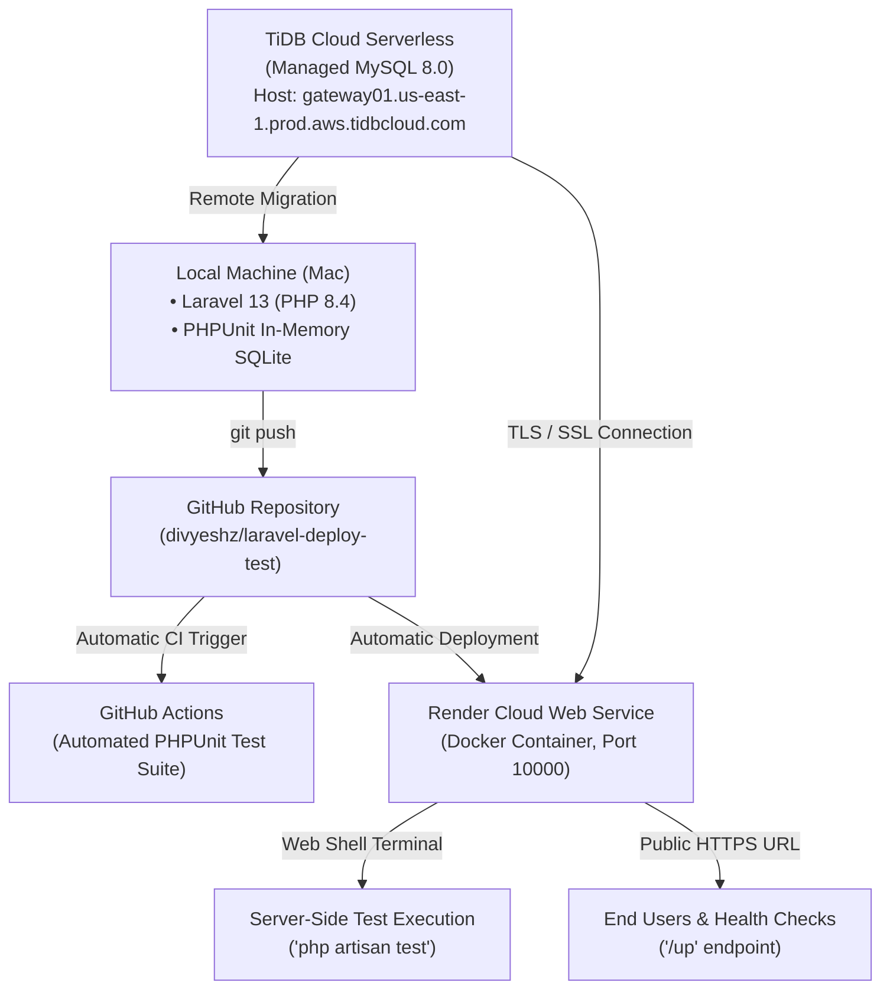

# Complete Beginner-Friendly Step-by-Step Guide: Deploying Laravel 13 with MySQL & Remote Unit Testing

**Project Repository:** [github.com/divyeshz/laravel-deploy-test](https://github.com/divyeshz/laravel-deploy-test)  
**Framework Version:** Laravel 13.38.0 (PHP 8.4)  
**Database:** TiDB Cloud Serverless (MySQL 8.0 Compatible)  
**Deployment Platform:** Render (Docker Web Service, Free Tier)  

---

## Table of Contents
1. [Overview & Architecture](#1-overview--architecture)
2. [Phase 1: Local Laravel 13 Project Setup](#phase-1-local-laravel-13-project-setup)
3. [Phase 2: Unit Testing & Database Isolation Setup](#phase-2-unit-testing--database-isolation-setup)
4. [Phase 3: GitHub Repository & Permission Setup](#phase-3-github-repository--permission-setup)
5. [Phase 4: TiDB Cloud MySQL Provisioning (Click-by-Click)](#phase-4-tidb-cloud-mysql-provisioning-click-by-click)
6. [Phase 5: Connecting Laravel to Cloud MySQL & Running Migrations](#phase-5-connecting-laravel-to-cloud-mysql--running-migrations)
7. [Phase 6: Containerization for Cloud Hosting (Dockerfile)](#phase-6-containerization-for-cloud-hosting-dockerfile)
8. [Phase 7: Deploying to Render (Guide for Senior / Lead)](#phase-7-deploying-to-render-guide-for-senior--lead)
9. [Phase 8: On-Server Unit Testing & Verification](#phase-8-on-server-unit-testing--verification)
10. [Bonus: Zero-Card Cloud Fallback via GitHub Codespaces](#bonus-zero-card-cloud-fallback-via-github-codespaces)
11. [Master Credentials & Environment Reference](#master-credentials--environment-reference)

---

## 1. Overview & Architecture

This guide covers the complete journey of creating, configuring, and deploying a modern **Laravel 13** web application with a cloud **MySQL** database on a free-tier hosting provider, with a primary focus on **running unit and feature tests directly inside the deployed server environment**.



---

## Phase 1: Local Laravel 13 Project Setup

### 1.1 Verify Prerequisites
Open your terminal and ensure your machine has the required tools installed:
```bash
php -v          # Must be PHP 8.3 or higher (we used PHP 8.4.15)
composer -V     # Composer 2.x
git --version   # Git installed
```

### 1.2 Create the Laravel 13 Project
From your terminal in your workspace directory (`/Users/ztlab60/learning`):
```bash
composer create-project laravel/laravel:^13.0 laravel-deploy-test
cd laravel-deploy-test
```
This downloads Laravel 13, generates the application key (`APP_KEY`), and installs all core dependencies.

### 1.3 Verify Local Installation
```bash
php artisan --version
# Output: Laravel Framework 13.38.0

php artisan about
```

---

## Phase 2: Unit Testing & Database Isolation Setup

A critical requirement is that running unit tests on the server must **never wipe or corrupt the live production database**.

### 2.1 Configure In-Memory Database Isolation in `phpunit.xml`
We configured `phpunit.xml` to force all tests to run against an in-memory SQLite database:

Open `phpunit.xml` and ensure the `<php>` block contains:
```xml
<php>
    <env name="APP_ENV" value="testing"/>
    <env name="DB_CONNECTION" value="sqlite"/>
    <env name="DB_DATABASE" value=":memory:"/>
    <env name="DB_URL" value=""/>
</php>
```
*Why this matters:* When tests execute with database transactions or `RefreshDatabase`, they only execute in temporary RAM memory. The live cloud MySQL database is 100% safe.

### 2.2 Add a Deployment Health Feature Test
We created `tests/Feature/ServerDeploymentTest.php` to verify both HTTP routing and database queries:
```php
<?php

namespace Tests\Feature;

use Illuminate\Support\Facades\DB;
use Tests\TestCase;

class ServerDeploymentTest extends TestCase
{
    /** Test HTTP health status */
    public function test_health_endpoint_returns_ok(): void
    {
        $response = $this->get('/up');
        $response->assertStatus(200);
    }

    /** Test database execution in test environment */
    public function test_database_queries_work_in_test_environment(): void
    {
        $result = DB::select('SELECT 1 as is_connected');
        $this->assertEquals(1, $result[0]->is_connected);
    }
}
```

Run tests locally to verify:
```bash
php artisan test
# Output: Tests: 4 passed (4 assertions)
```

---

## Phase 3: GitHub Repository & Permission Setup

### 3.1 Initialize Git
```bash
git init
git branch -M main
git add .
git commit -m "Initialize Laravel 13 project with unit tests and health endpoints"
```

### 3.2 Create the Remote Repository on GitHub
1. Open your browser and go to: **[github.com/new](https://github.com/new)**.
2. Set Repository Name: `laravel-deploy-test`.
3. Set Visibility: **Public**.
4. Leave "Add a README file" unchecked (since we already have a project).
5. Click **Create repository**.
6. Repository URL: `https://github.com/divyeshz/laravel-deploy-test.git`.

### 3.3 Fine-Grained Personal Access Token (PAT) Configuration
If your Mac keychain uses a different GitHub account (e.g. `darkhunter1107`), you must push using a Personal Access Token for `divyeshz`.

> [!IMPORTANT]
> **Why Fine-Grained Tokens Fail by Default:**
> By default, GitHub Fine-Grained tokens only have `Metadata: Read` permission. Attempting to push returns `403 Permission denied`.

**Exact steps to grant correct permissions:**
1. Go to: **[github.com/settings/tokens?type=beta](https://github.com/settings/tokens?type=beta)**.
2. Click on your token name (e.g. `laravel-deploy-test`).
3. Under **Repository access**, choose **Only select repositories** → select `divyeshz/laravel-deploy-test`.
4. Under **Permissions** → Click **`+ Add permissions`**:
   * Find **`Contents`** → Set to **Read and write** *(allows pushing code)*.
   * Find **`Workflows`** → Set to **Read and write** *(required because the project has `.github/workflows/tests.yml`)*.
5. Click the green **Save changes** button at the bottom.

### 3.4 Push the Code to GitHub
```bash
git remote add origin https://github.com/divyeshz/laravel-deploy-test.git
git push https://divyeshz:<YOUR_TOKEN>@github.com/divyeshz/laravel-deploy-test.git main --set-upstream
```
Once pushed, remove the token from plain text in git config:
```bash
git remote set-url origin https://github.com/divyeshz/laravel-deploy-test.git
```

### 3.5 Automated GitHub Actions CI Testing
We created `.github/workflows/tests.yml`. On every push, GitHub automatically runs a clean virtual machine, installs dependencies, and runs `php artisan test`. You can view passing runs at:  
👉 **[github.com/divyeshz/laravel-deploy-test/actions](https://github.com/divyeshz/laravel-deploy-test/actions)**

---

## Phase 4: TiDB Cloud MySQL Provisioning (Click-by-Click)

TiDB Cloud provides a 100% free-forever, fully MySQL 8.0-compatible cloud database (25 GB storage, zero credit card required).

### 4.1 Sign Up
1. Visit: **[https://tidbcloud.com](https://tidbcloud.com)**.
2. Click **Sign in with GitHub**.
3. Authorize with your GitHub account (`divyeshz`).

### 4.2 Create the Free MySQL Instance
1. In the TiDB Cloud Console, look at the top right and click the black **`Create Resource`** button.
2. **Select the Plan:**
   * **CAUTION:** The console defaults to "Essential" ($480/month).
   * **Click the `Starter` card on the far left:**
     * It says: *"POWERED BY TIDB X - For applications with variable workloads. Free for developers and AI agents. From $0/month"*.
3. **Basic Settings:**
   * **Instance Name:** Enter `laravel-db`.
   * **Cloud Provider:** `AWS`.
   * **Region:** Select `N. Virginia (us-east-1)` (or region closest to your app).
4. **Create:**
   * Notice the bottom right button says **`Create`** (not "Add Credit Card").
   * Click **`Create`**. The cluster initializes in ~5 seconds.

### 4.3 Retrieve MySQL Connection Details
1. On the cluster overview page, click the **`Connect`** button on the top right.
2. In the modal:
   * Click **`Generate Password`**.
   * Copy and save the generated password immediately (it is only shown once).
3. The modal displays your live parameters:
   * **HOST:** `gateway01.us-east-1.prod.aws.tidbcloud.com`
   * **PORT:** `4000`
   * **USERNAME:** `3jt3Gx4NohCuJrR.root`
   * **PASSWORD:** `VWJSq7Ak086DaJRp`
   * **DATABASE:** `sys` (or `test`)
   * **CA Certificate:** `/etc/ssl/cert.pem` (macOS) or `/etc/ssl/certs/ca-certificates.crt` (Linux)

> [!NOTE]
> **Why TiDB requires SSL / TLS:**
> TiDB Cloud enforces secure transport. Connections without TLS will fail with: `SQLSTATE[HY000] [1105] Connections using insecure transport are prohibited`. We configured Laravel to automatically pass `MYSQL_ATTR_SSL_CA`.

---

## Phase 5: Connecting Laravel to Cloud MySQL & Running Migrations

### 5.1 Test Connection via PHP PDO
From your local terminal, we verified the TLS connection to TiDB Cloud:
```bash
php -r '
$pdo = new PDO("mysql:host=gateway01.us-east-1.prod.aws.tidbcloud.com;port=4000;dbname=test", "3jt3Gx4NohCuJrR.root", "VWJSq7Ak086DaJRp", [
    PDO::MYSQL_ATTR_SSL_CA => "/etc/ssl/cert.pem",
    PDO::MYSQL_ATTR_SSL_VERIFY_SERVER_CERT => false,
]);
$pdo->exec("CREATE DATABASE IF NOT EXISTS laravel_deploy_test");
echo "Connected and laravel_deploy_test database ready!\n";
'
```

### 5.2 Execute Remote Migrations
We executed Laravel 13 migrations directly against the cloud TiDB database:
```bash
MYSQL_ATTR_SSL_CA="/etc/ssl/cert.pem" \
DB_CONNECTION=mysql \
DB_HOST=gateway01.us-east-1.prod.aws.tidbcloud.com \
DB_PORT=4000 \
DB_DATABASE=laravel_deploy_test \
DB_USERNAME="3jt3Gx4NohCuJrR.root" \
DB_PASSWORD="VWJSq7Ak086DaJRp" \
php artisan migrate
```
**Output:**
```text
INFO Preparing database.
Creating migration table .. 1s DONE
INFO Running migrations.
0001_01_01_000000_create_users_table .. 3s DONE
0001_01_01_000001_create_cache_table .. 2s DONE
0001_01_01_000002_create_jobs_table .. 3s DONE
```
The cloud MySQL database now contains all necessary tables.

---

## Phase 6: Containerization for Cloud Hosting (Dockerfile)

Because cloud hosts (such as Render) do not have a native "PHP" selection in their free tiers, we containerized the application with a production `Dockerfile`.

We created and pushed [`Dockerfile`](file:///Users/ztlab60/learning/laravel-deploy-test/Dockerfile):
```dockerfile
FROM php:8.4-cli

# Install system dependencies
RUN apt-get update && apt-get install -y \
    git \
    curl \
    libpng-dev \
    libonig-dev \
    libxml2-dev \
    libsqlite3-dev \
    zip \
    unzip \
    ca-certificates \
    && rm -rf /var/lib/apt/lists/*

# Install PHP extensions required for Laravel, MySQL, and testing
RUN docker-php-ext-install pdo pdo_mysql pdo_sqlite bcmath

# Copy Composer from official image
COPY --from=composer:latest /usr/bin/composer /usr/bin/composer

# Set working directory
WORKDIR /var/www

# Copy application code
COPY . .

# Install dependencies (preserving PHPUnit for server-side testing)
RUN composer install --no-interaction --prefer-dist --optimize-autoloader

# Ensure proper storage permissions
RUN chmod -R 777 storage bootstrap/cache

# Default port for cloud platforms
ENV PORT=10000
EXPOSE 10000

# Start Laravel development server bound to assigned port
CMD ["sh", "-c", "php artisan serve --host=0.0.0.0 --port=${PORT:-10000}"]
```

---

## Phase 7: Deploying to Render (Guide for Senior / Lead)

Render provides a Free Web Service ($0/month) that builds directly from our `Dockerfile`.

> [!NOTE]
> **Why Render asks for a Card:**
> Render displays an "Add Card" modal for anti-abuse validation ($1 temporary authorization hold reversed immediately). The plan selected is **Free ($0/month)**.

### Step 7.1: Connect Repository
1. Log in to [render.com](https://render.com).
2. Click **New +** → **Web Service**.
3. Select **Build and deploy from a Git repository**.
4. Connect: **`divyeshz/laravel-deploy-test`** (Branch: `main`).

### Step 7.2: Basic Configuration
* **Name:** `laravel-deploy-test`
* **Region:** *Singapore*, *Frankfurt*, or *Ohio (US East)*
* **Language:** Select **`Docker`** *(Do NOT select Node/Python; Docker automatically uses our `Dockerfile`)*.
* **Instance Type:** Select **`Free ($0/month)`**.

### Step 7.3: Environment Variables
Scroll down to **Environment Variables** and add:

| Key | Value | Notes |
| :--- | :--- | :--- |
| `APP_NAME` | `LaravelDeployTest` | Application name |
| `APP_ENV` | `production` | Production environment |
| `APP_DEBUG` | `false` | Disable debug traces |
| `APP_KEY` | `base64:VrjO2KzMD+W8rstf6WXJ/6Kz8RQRSc7mdFhjfhyddTY=` | Cryptographic key |
| `LOG_CHANNEL` | `stderr` | Sends logs to Render dashboard |
| `DB_CONNECTION` | `mysql` | MySQL driver |
| `DB_HOST` | `gateway01.us-east-1.prod.aws.tidbcloud.com` | TiDB Cloud Host |
| `DB_PORT` | `4000` | TiDB Port |
| `DB_DATABASE` | `laravel_deploy_test` | Cloud database name |
| `DB_USERNAME` | `3jt3Gx4NohCuJrR.root` | TiDB Username |
| `DB_PASSWORD` | `VWJSq7Ak086DaJRp` | TiDB Password |
| `MYSQL_ATTR_SSL_CA` | `/etc/ssl/certs/ca-certificates.crt` | Linux system SSL CA certificate |

### Step 7.4: Deploy
1. Click **Deploy Web Service**.
2. Complete the card verification prompt.
3. Render builds the Docker image and launches your service with a public URL (e.g. `https://laravel-deploy-test.onrender.com`).

---

## Phase 8: On-Server Unit Testing & Verification

### 8.1 Execute Tests Directly Inside the Render Server
1. In the Render Dashboard, open your deployed `laravel-deploy-test` service.
2. Click the **Shell** tab on the left sidebar.
3. In the web terminal, run:
   ```bash
   php artisan test
   ```
   **Expected Output:**
   ```text
      PASS  Tests\Unit\ExampleTest
     ✓ that true is true

      PASS  Tests\Feature\ExampleTest
     ✓ the application returns a successful response

      PASS  Tests\Feature\ServerDeploymentTest
     ✓ health endpoint returns ok
     ✓ database queries work in test environment

     Tests:    4 passed (4 assertions)
     Duration: 0.14s
   ```

4. Verify database status directly from the container:
   ```bash
   php artisan db:show
   ```

### 8.2 Test Public HTTP Endpoints
From any computer or mobile browser:
```bash
# Verify home route (Laravel Welcome Page)
curl -I https://<YOUR-RENDER-URL>.onrender.com

# Verify health status endpoint
curl -i https://<YOUR-RENDER-URL>.onrender.com/up
```
*Expected Status Code:* `HTTP/1.1 200 OK`

---

## Bonus: Zero-Card Cloud Fallback via GitHub Codespaces

If you need to test right now without a credit card:

1. Open: **[github.com/divyeshz/laravel-deploy-test](https://github.com/divyeshz/laravel-deploy-test)**.
2. Click **<> Code** → **Codespaces** → Click your codespace (`haunted spooky owl`).
3. In the cloud terminal, run:
   ```bash
   composer install
   bash setup-env.sh
   php artisan test
   php artisan serve --host=0.0.0.0 --port=8000
   ```
4. Click the **Ports** tab at the bottom, right-click Port `8000` → set **Port Visibility** to **Public**.
5. Click the globe icon to open your live public URL (`https://<codespace>-8000.app.github.dev`).

---

## Master Credentials & Environment Reference

```env
APP_NAME=LaravelDeployTest
APP_ENV=production
APP_DEBUG=false
APP_KEY=base64:VrjO2KzMD+W8rstf6WXJ/6Kz8RQRSc7mdFhjfhyddTY=
LOG_CHANNEL=stderr

DB_CONNECTION=mysql
DB_HOST=gateway01.us-east-1.prod.aws.tidbcloud.com
DB_PORT=4000
DB_DATABASE=laravel_deploy_test
DB_USERNAME=3jt3Gx4NohCuJrR.root
DB_PASSWORD=VWJSq7Ak086DaJRp
MYSQL_ATTR_SSL_CA=/etc/ssl/certs/ca-certificates.crt
```
